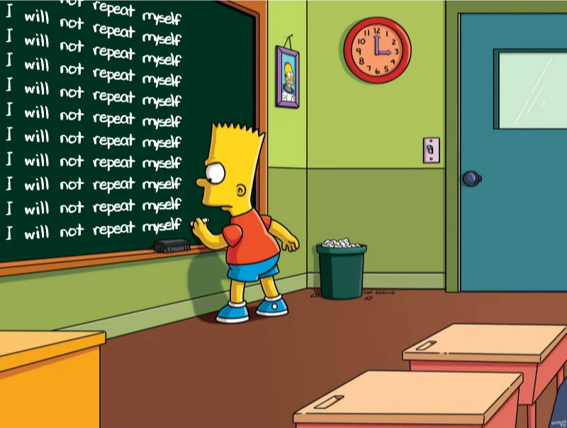
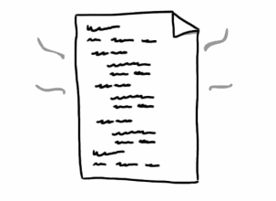
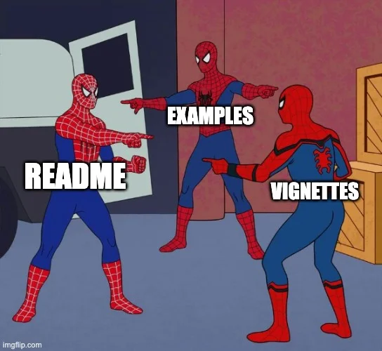

---
format:
  revealjs:
    css: style.css
    theme: solarized
    revealjs-plugins:
      - a11y
      - read-aloud
    revealjs-a11y:
      # 0.2.3's menus introduce ARIA failures; retain our slide-menu handling.
      slide-menu-a11y: false
      menu: false
      # Use the extension's core accessibility fixes without extra UI/shortcuts.
      font-size-controls: false
      font-selection: false
      text-spacing: false
      transcript: false
      slide-change-cue: false
    slide-number: true
    code-line-numbers: false
    preview-links: auto
    keyboard: true
    touch: true
    help: true
    include-in-header: meta-tags.html
    include-after-body: accessibility.html
    link-external-newwindow: true
execute:
  echo: false
  eval: false
keywords: ["software-engineering", "r-packages", "best-practices", "DRY"]
description-meta: "Learn how to apply the DRY (Don't Repeat Yourself) principle to R package development. Covers documentation, vignette setup, unit testing, data management, dependency management, and exception handling to make your R packages more maintainable."
license: "CC0 1.0 Universal"
pagetitle: "DRY R Package Development"
author-meta: "Indrajeet Patil"
date-meta: "2022-11-17"
lang: "en"
dir: "ltr"
image: "media/social-media-card.webp"
image-alt: "Preview image for presentation about DRY (Don't Repeat Yourself) principle in R package development"
canonical-url: "https://www.indrapatil.com/dry-r-package-development/"
---

## DRY Package Development in R {.nostretch style="text-align: center;"}

::: {style="text-align: center;"}

Indrajeet Patil

:::

```{r}
#| echo: false
#| eval: true
#| out-height: 390px
#| fig-alt: "Bart Simpson repeatedly writes I will not repeat myself on a blackboard."

```

::: {style="text-align: center; font-size: 0.7em; margin-top: 2em; color: #666;"}
Source code for these slides can be found [on GitHub](https://github.com/IndrajeetPatil/dry-r-package-development/){style="text-decoration: underline;"}.
:::

::: {.notes}
- Welcome everyone to this presentation on applying the DRY principle to R package development.
- Introduce the motivation: R package development involves multiple interrelated artefacts including documentation, tests, vignettes, and code.
- Frame the core challenge: keeping these components consistent without drowning in duplicate maintenance.
:::

# <span class="visually-hidden">Copy and paste</span> {#section}

*"Copy and paste is a design error."* &nbsp; \- David Parnas

::: {.notes}
- Pause on this classic quote by computer scientist David Parnas: "Copy and paste is a design error."
- Emphasise that copying and pasting is often the easiest short-term action, but it creates hidden long-term technical debt.
:::

# Why So DRY

Why should you not repeat yourself?

::: {.notes}
- Transition into the introductory section: Why So DRY.
- Introduce the motivation for eliminating repetition in software projects.
:::

## Don't Repeat Yourself (DRY) Principle {.smaller}

:::: {.columns}

::: {.column width='60%'}

The DRY Principle states that:

::: {style="color: red;"}

*Every piece of **knowledge** must have a **single** representation in the codebase.*

:::

That is, you should not express the same thing in multiple places in multiple ways.

:::

::: {.column width='40%'}

```{r, echo=FALSE, eval=TRUE}
#| fig-alt: "Animated illustration of a document."

```

:::

::::

. . . 

:::{.callout-note}

## It's about *knowledge* and not just *code*

The DRY principle is about duplication of knowledge.
Thus, it applies to all programming entities that encode knowledge:

- You should not duplicate code.
- You should not duplicate intent across code and comments.
- You should not duplicate knowledge in data structures.
- ...

:::

::: {.notes}
- Define the DRY principle as formulated by Andy Hunt and Dave Thomas in "The Pragmatic Programmer".
- Emphasise that every piece of knowledge must have a single, unambiguous, authoritative representation within a system.
- Walk through the callout note: stress that DRY applies to knowledge, not merely lines of code; this includes documentation, data structures, and tests.
:::

## Benefits of DRY codebase {.smaller}

- Duplicated code requires parallel changes in multiple places; DRY code eliminates this need.

- Easier to maintain - update knowledge in one place only.

- Routines developed to remove duplicated code can become general-purpose utilities.

<br>

. . . 

:::{.callout-tip}

## Further Reading 

- Thomas, D., & Hunt, A. (2019). *The Pragmatic Programmer*. Addison-Wesley Professional. (**pp. 30-38**)

- Understand distinction between DRY and [DAMP (Descriptive And Meaningful Phrases)](https://stackoverflow.com/questions/6453235/what-does-damp-not-dry-mean-when-talking-about-unit-tests)

:::

::: {.notes}
- Walk through the four key benefits of maintaining a DRY codebase:
  - Eliminating parallel changes across multiple files.
  - Making maintenance easier by updating knowledge in exactly one location.
  - Reducing bug surface area, since bug fixes immediately propagate everywhere.
  - Improving readability and lowering cognitive overhead for new contributors.
- Highlight the recommended reading in the callout box: *The Pragmatic Programmer* (pp. 30–38) and the distinction between DRY and DAMP (Descriptive And Meaningful Phrases) in testing contexts.
:::

# Plan

Apply DRY to remove duplication in:

- Documentation
- Vignette setup
- Unit testing
- Dependency management
- Exceptions

::: {.notes}
- Outline the agenda for the talk across six package development domains:
  - Documentation,
  - Vignette setup,
  - Example data,
  - Unit testing,
  - Exceptions and error handling, and
  - Dependency management.
:::

# Documentation

Avoiding repetition in documentation.

::: {.notes}
- Transition to the first major topic: eliminating repetition across R package documentation.
- Highlight that documentation is often the most duplicated artefact in an R package.
:::

## What do users read? {.smaller}

Users consult different sources depending on context.

<br>

. . .

<span class="deck-icon deck-icon-2xl deck-icon-brands-readme" role="img" aria-label="readme"></span> **README**: While exploring the package repository.

<br>

<span class="deck-icon deck-icon-2xl deck-icon-solid-file" role="img" aria-label="file"></span> **Vignettes**: When first learning how to use a package.

<br>

<span class="deck-icon deck-icon-2xl deck-icon-solid-file-invoice" role="img" aria-label="file invoice"></span> **Manual**: When checking details about a specific function.

<br>

. . .

Including crucial information in only one place risks users missing it in certain contexts.

::: {.notes}
- Contrast the different entry points through which users encounter package documentation:
  - Function reference manual pages (via help queries or pkgdown references),
  - Long-form vignettes (via `vignette()` or online articles), and
  - The repository README and website landing page.
- Note that each surface serves a different user journey and context.
:::

## Go forth and multiply (without repetition) {.smaller}

:::: {.columns}

::: {.column width='40%'}

Some documentation is important enough to be included in multiple places (e.g. in the function documentation and in a vignette).

<br>

> How can you document something just *once* but include it in *multiple* locations?

:::

::: {.column width='60%'}

```{r, echo=FALSE, eval=TRUE, out.width="100%"}
#| fig-alt: "Three Spider-Man figures labelled README, examples, and vignettes point at one another, illustrating duplicated documentation."

```

:::

::::

::: {.notes}
- Explain the dilemma: certain crucial content (such as installation instructions, citations, or common parameter descriptions) belongs on multiple documentation surfaces.
- Frame the problem: copying markdown text between README, vignettes, and roxygen comments leads to divergence and stale docs.
:::

## Child documents {.smaller}

You can stitch an R Markdown document from smaller [child documents](https://bookdown.org/yihui/rmarkdown-cookbook/child-document.html).

```{mermaid}
%%| eval: true
%%| fig-width: 7
%%| fig-height: 4.5
graph LR
    A[Parent Rmd] --> C[Result Rmd]
    B[Child Rmd] --> C
    style A fill:#e1f5ff
    style B fill:#fff4e1
    style C fill:#e8f5e9
```

. . .

Information is stored *once* in child documents and reused *multiple* times across parents.

::: {.notes}
- Introduce knitr child documents as a fundamental building block for modular documentation.
- Explain the syntax: using ````{r, child="child.Rmd"}```` to include another document during rendering.
- Note that child documents are rendered in the environment of the parent document, allowing dynamic reuse.
:::

## Storing child documents in package {.smaller}

Store child documents in the manual directory and reuse them.

:::: {.columns}

::: {.column width='30%'}

**Child documents**

```
├── DESCRIPTION
├── man
│   └── rmd-children
│       └── info1.Rmd
│       └── ...
```

:::

::: {.column width='70%'}

````{.markdown filename="info1.Rmd"}
This is some crucial information to be repeated across documentation.

```{{r}}
1 + 1
```

````

:::

::::

<br>

:::{.callout-tip}

## Tips

- Include as many child documents as needed.
- Child documents are standard `.Rmd` files with full `.Rmd` capabilities.
- You can choose a different name for the folder containing child documents (e.g. `rmd-fragments`).
- Make sure to include `Roxygen: list(markdown = TRUE)` field in the `DESCRIPTION` file.
- The child documents will not pose a problem either for `R CMD check` or for `{pkgdown}` website.

:::

::: {.notes}
- Walk through where child documents should reside within an R package directory structure.
- Point to the tree diagram: store reusable `.Rmd` fragments in `man/rmd-fragments/`.
- Explain the advantages: `man/` is a standard package directory that roxygen2 natively inspects, keeping fragments cleanly organised away from primary vignettes.
:::

## Using child documents in package: Part-1 {.smaller}

Include child document contents in multiple documentation locations.

. . . 

:::: {.columns}

::: {.column width='50%'}

**Vignette**

```
├── DESCRIPTION
├── vignettes
│   └── vignette1.Rmd
│   └── ...
│   └── web_only
│       └── vignette2.Rmd
│       └── ...
```

:::

::: {.column width='50%'}

**README**

```
├── DESCRIPTION
├── README.Rmd
```

:::

::::

. . . 

:::: {.columns}

::: {.column width='50%'}

````{.markdown filename="vignette1.Rmd"}
---
output: html_vignette
---

Vignette content.

```{{r}}, child="../man/rmd-children/info1.Rmd"}
```

````

:::

::: {.column width='50%'}

````{.markdown filename="README.Rmd"}
---
output: github_document
---

README content.

```{{r}}, child="man/rmd-children/info1.Rmd"}
```

````

:::

::::

::: {.notes}
- Demonstrate including child documents in vignettes and `README.Rmd`.
- Walk through knitr's ````{r, child="..."}```` chunk option across both files.
- Note the relative path difference: `../man/rmd-children/` from the `vignettes/` directory versus `man/rmd-children/` from the repository root for `README.Rmd`.
:::

## Using child documents in package: Part-2 {.smaller}

Include child document contents in multiple documentation locations.

:::: {.columns}

::: {.column width='30%'}

**Manual**

```
├── DESCRIPTION
├── R
│   └── foo1.R
│   └── foo2.R
├── man
│   └── foo1.Rd
│   └── foo2.Rd
│   └── ...
```

:::

::: {.column width='50%'}

```{.r filename="foo1.R"}
#' @title Foo1
#' @section Information:
#'
#' ```{r, child="man/rmd-children/info1.Rmd"}
#' ```
foo1 <- function() { ... }
```

:::

::::

<br>

:::{.callout-important}

The underlying assumption here is that you are using [`{roxygen2}`](https://roxygen2.r-lib.org/) to generate package documentation.

:::

::: {.notes}
- Demonstrate including the same child document in roxygen2 function documentation.
- Show how the knitr chunk is placed inside a roxygen `@section` block in `R/foo1.R`.
- Highlight the callout: this pattern relies on roxygen2 to process and stitch the markdown fragment into generated `.Rd` manual files.
:::

## What about non-child documents? {.smaller}

You can include contents from **any** file in `.Rmd`, not just a child document!

```{mermaid}
%%| eval: true
%%| fig-width: 14
%%| fig-height: 4
graph TD
    A[Parent Rmd] --> F[Result Rmd]
    B[Child Rmd] --> F
    C[.R file<br/>R engine] --> F
    D[.md file<br/>asis engine] --> F
    E[...] --> F
    style A fill:#e1f5ff
    style B fill:#fff4e1
    style C fill:#ffe1f5
    style D fill:#f5e1ff
    style E fill:#f0f0f0
    style F fill:#e8f5e9
```

::: {.notes}
- Address content that does not naturally live in a `.Rmd` child document.
- Examples include plain markdown files, system requirement lists, citation files (`CITATION.cff`), or external licenses.
:::

## Storing other documentation files in package {.smaller}

Like child documents, store other document types in the `man/` folder.

:::: {.columns}

::: {.column width='30%'}

**Reusable content**

```
├── DESCRIPTION
├── man
│   └── rmd-children
│       └── info1.Rmd
│       └── ...
│   └── md-fragments
│       └── fragment1.md
│       └── ...
│   └── r-chunks
│       └── chunk1.R
│       └── ...
```

:::

::: {.column width='35%'}

````{.markdown filename="fragment1.md"}
This `.md` file contains
content to be included *as is*
across multiple locations
in the documentation.
````

:::

::: {.column width='35%'}

````{.markdown filename="chunk1.R"}
# some comment and code
1 + 1

# more comments and code
2 + 3
````

:::

::::

<br>

:::{.callout-note}

## Folder names

Name folders to describe their contents (e.g., `r-examples`, `yaml-snippets`, `md-fragments`).

:::

::: {.notes}
- Explain package conventions for storing arbitrary documentation files.
- Discuss using `man/` or `inst/` depending on whether the files need to be accessible at package runtime.
- Review the note on folder naming and avoiding name collisions with standard R directories.
:::

## Using non-child documents in package: Part-1 {.smaller}

Include various file contents in multiple documentation locations.

. . . 

:::: {.columns}

::: {.column width='50%'}

**Vignette**

```
├── DESCRIPTION
├── vignettes
│   └── vignette1.Rmd
│   └── ...
│   └── web_only
│       └── vignette2.Rmd
│       └── ...
```

:::

::: {.column width='50%'}

**README**

```
├── DESCRIPTION
├── README.Rmd
```

:::

::::

. . . 

:::: {.columns}

::: {.column width='50%'}

````{.markdown filename="vignette1.Rmd"}
---
output: html_vignette
---

Vignette content.

```{{asis}}, file="../man/md-fragments/fragment1.md"}
```

```{{r}}, file="../man/r-chunks/chunk1.R"}
```

````

:::

::: {.column width='50%'}

````{.markdown filename="README.Rmd"}
---
output: github_document
---

README content.

```{{asis}}, file="man/md-fragments/fragment1.md"}
```

```{{r}}, file="man/r-chunks/chunk1.R"}
```

````

:::

::::

::: {.notes}
- Demonstrate including non-child files in vignettes and `README.Rmd`.
- Walk through knitr's `asis` engine with the `file` chunk option for `.md` fragments, and the `r` engine with `file` for external `.R` scripts.
- Note how relative directory paths are structured between `vignettes/` and the package root.
:::

## Using non-child documents in package: Part-2 {.smaller}

Include child document contents in multiple documentation locations.

:::: {.columns}

::: {.column width='30%'}

**Manual**

```
├── DESCRIPTION
├── R
│   └── foo1.R
│   └── ...
├── man
│   └── foo1.Rd
│   └── ...
```

:::

::: {.column width='50%'}

```{.r filename="foo1.R"}
#' @title Foo1
#' @section Information:
#'
#' ```{r, file="man/md-fragments/fragment1.Rmd"}
#' ```
#'
#' @example man/r-chunks/chunk1.R
foo1 <- function() { ... }
```

:::

::::

<br>

:::{.callout-important}

The underlying assumption here is that you are using [`{roxygen2}`](https://roxygen2.r-lib.org/) to generate package documentation.

:::

::: {.notes}
- Demonstrate including non-child documents in roxygen2 function documentation.
- Show how external markdown fragments are included via knitr's `file` chunk option, and external R code is attached via roxygen's `@example` tag.
- Emphasise that documentation and example code update automatically when the single source file is modified.
:::

## <span class="visually-hidden">Documentation summary</span> {#section-1}

:::{.callout-tip}

## Summary on how to repeat documentation

If you are overwhelmed by this section, note that you actually need to remember only the following rules:

- Store reusable document files in the `/man` folder.

- When you wish to include their contents, provide paths to these files **relative** to the document you are linking from.

- If it's a child `.Rmd` document, use the `child` option to include its contents.

- If it's not an `.Rmd` document, use the `file` option to include its contents and use appropriate `{knitr}` engine. To see available engines, run `names(knitr::knit_engines$get())`.

- For function documentation, prefer `{roxygen2}`'s reuse tags when the repeated content already belongs to another topic: `@inheritParams`, `@inheritSection`, `@inheritDotParams`, or `@inherit` for several fields at once. Use `@describeIn` or `@rdname` when related functions should share one help page.

:::

::: {.notes}
- Summarise the core documentation reuse rules: keep reusable documents in `/man` and specify paths relative to the calling document.
- Recap the knitr mechanisms: use the `child` option for child `.Rmd` documents, and the `file` option with an appropriate engine for non-`.Rmd` files.
- Recap roxygen2 inheritance tags (`@inheritParams`, `@inheritSection`, `@inheritDotParams`, `@inherit`) when repeating documentation across function topics, or `@describeIn` and `@rdname` to combine related functions into a single topic.
:::

## Self-study {aria-label="Self-study: Documentation"}

Example packages that use reusable component documents to repeat documentation.

- [`{pkgdown}`](https://github.com/r-lib/pkgdown/tree/v2.0.9/man/rmd-fragments) (pinned to `v2.0.9`: the fragments were removed upstream after that release)

- [`{ggstatsplot}`](https://github.com/IndrajeetPatil/ggstatsplot/tree/main/man)

::: {.notes}
- Direct attendees to real-world packages demonstrating reusable documentation fragments.
- Highlight packages like `{pkgdown}` and `{ggstatsplot}` as real-world references in the R ecosystem.
:::

# Vignette Setup

Avoiding repetition in vignette setup.

::: {.notes}
- Transition to the second domain: vignette setup chunks.
- Discuss the common pain point of duplicating chunk options, package attachments, and hooks across multiple vignettes.
:::

## Setup chunks in vignettes {.smaller}

Setup chunks for vignettes often contain duplication.

Some setup code is identical across vignettes.

<br>

:::: {.columns}

::: {.column width='25%'}

```
├── DESCRIPTION
├── vignettes
│   └── vignette1.Rmd
│   └── vignette2.Rmd
│   └── ...
```

:::

::: {.column width='37%'}

````{.markdown filename="vignette1.Rmd"}
---
title: "Vignette-1"
output: html_vignette
---

```{{r}}
knitr::opts_chunk$set(
  message = FALSE,
  collapse = TRUE,
  comment = "#>"
)
```

````

:::

::: {.column width='37%'}

````{.markdown filename="vignette2.Rmd"}
---
title: "Vignette-2"
output: html_vignette
---

```{{r}}
knitr::opts_chunk$set(
  message = FALSE,
  collapse = TRUE,
  comment = "#>"
)

options(crayon.enabled = TRUE)
```

````

:::

::::

<br>

How can this repetition be avoided?

::: {.notes}
- Point out the typical boilerplate repeated at the start of every package vignette.
- Walk through the example: setting `knitr::opts_chunk$set(...)`, loading libraries, and configuring graphics devices.
- Highlight the maintenance hazard: changing a default chunk option requires manually editing every vignette in the package.
:::

## Sourcing setup chunks in vignettes {.smaller}

:::: {.columns}

::: {.column width='60%'}

Avoid this by moving **common** setup to a script and sourcing it from vignettes. If you have many reusable artefacts, store scripts in a `/setup` folder.

:::

::: {.column width='20%'}

**Option 1**

```
├── DESCRIPTION
├── vignettes
│   └── setup.R
```

:::

::: {.column width='20%'}

**Option 2**

```
├── DESCRIPTION
├── vignettes
│   └── setup
│       └── setup.R
```

:::

::::

. . . 

:::: {.columns}

::: {.column width='26%'}

Common setup

```{.r filename="setup.R"}
knitr::opts_chunk$set(
  message = FALSE,
  collapse = TRUE,
  comment = "#>"
)
```

:::

::: {.column width='37%'}

Sourcing common setup

````{.markdown filename="vignette1.Rmd"}
---
title: "Vignette-1"
output: html_vignette
---

```{{r}} setup, include = FALSE}
source("setup/setup.R")
```

````

:::

::: {.column width='37%'}

Sourcing common setup

````{.markdown filename="vignette2.Rmd"}
---
title: "Vignette-2"
output: html_vignette
---

```{{r}} setup, include = FALSE}
source("setup/setup.R")
options(crayon.enabled = TRUE)
```

````

:::

::::

. . . 

:::{.callout-tip}

## No parallel modification

Modify common setup in *one* place only!

:::

::: {.notes}
- Present the DRY solution: extract common vignette configuration into a dedicated script such as `vignettes/setup.R`.
- Show how each vignette simply sources this file using `source("setup.R")` or knitr chunk options.
- Highlight the slide callout: parallel modifications are completely eliminated when global vignette settings change.
:::

## Self-study {aria-label="Self-study: Vignette setup"}

Packages in the wild that use this trick.

- [`{dm}`](https://github.com/cynkra/dm/blob/main/vignettes/setup/setup.R)

::: {.notes}
- Provide real-world package references that adopt centralised vignette setup scripts.
- Mention `{dm}` as a prime example of cleanly factored vignette configuration.
:::

# Data

Avoiding repetition with example datasets.

::: {.notes}
- Transition to the third domain: managing example datasets in R packages.
- Frame the problem: generating ad-hoc mock datasets repeatedly across examples, tests, and documentation.
:::

## Illustrative example datasets {.smaller}

Create new datasets when existing ones don't illustrate your functions well.

. . .

Using dataset `exdat` with function `foo()` in examples, vignettes, and README requires defining it *multiple* times.

:::: {.columns}

::: {.column width='33%'}

**In examples**

```{.r filename="foo.R"}
#' @examples
#' exdat <- matrix(c(71, 50))
#' foo(exdat)
```

:::

::: {.column width='33%'}

**In vignettes**

````{.markdown filename="vignette.Rmd"}
---
title: "My Vignette"
output: html_vignette
---

```{{r}}
exdat <- matrix(c(71, 50))
foo(exdat)
```
````

:::

::: {.column width='33%'}

**In README**

````{.markdown filename="README.Rmd"}
---
output: github_document
---

```{{r}}
exdat <- matrix(c(71, 50))
foo(exdat)
```
````

:::

::::

<br>

. . . 

How can this repetition be avoided?

::: {.notes}
- Explain why built-in datasets like `mtcars` or `iris` are often insufficient for demonstrating package-specific features or complex workflows.
- Show how developers frequently reinvent mock dataframes in every vignette and test script.
:::

## Shipping data in a package {.smaller}

Define data *once*, save it, and ship it with the package.

Store datasets in `data/` and document them in `R/data.R`.

. . . 

:::: {.columns}

::: {.column width='60%'}

**Saving data**

```{.r filename="exdat.R"}
exdat <- matrix(c(71, 50))
save(exdat, file="data/exdat.rdata")
```

:::

::: {.column width='40%'}

**Directory structure**

```
├── DESCRIPTION
├── R
├── data-raw
│   └── exdat.R
├── data
│   └── exdat.rdata
├── R
│   └── data.R
```

:::

::::

. . . 

:::{.callout-caution}

## Don't forget!

- Save the creation script in `data-raw/` for future updates.
- Set `LazyData: true` in `DESCRIPTION` when including datasets.

:::

::: {.notes}
- Walk through the standard R pattern for saving reusable package datasets: saving to `data/` or using `usethis::use_data()`.
- Explain that data saved in `data/` is compressed and lazily loaded when `LazyData: true` is configured in `DESCRIPTION`.
- Highlight the caution callout: keep the creation script in `data-raw/` for reproducibility, and remember that dataset documentation must still be written separately in `R/data.R`.
:::

## Reusable dataset {.smaller}

`exdat` can now be used everywhere without redefining it.

:::: {.columns}

::: {.column width='33%'}

**In examples**

```{.r filename="foo.R"}
#' @examples
#' foo(exdat)
```

:::

::: {.column width='33%'}

**In vignettes**

````{.markdown filename="vignette.Rmd"}
---
title: "My Vignette"
output: html_vignette
---

```{{r}}
foo(exdat)
```
````

:::

::: {.column width='33%'}

**In README**

````{.markdown filename="README.Rmd"}
---
output: github_document
---

```{{r}}
foo(exdat)
```
````

:::

::::

<br>


:::{.callout-tip}

## No parallel modification

Update the dataset in *one* place only!

:::

::: {.notes}
- Walk through the three reuse contexts shown across the columns:
  - In roxygen2 function examples (`foo.R`).
  - In package vignettes (`vignette.Rmd`).
  - In the package `README.Rmd`.
- Emphasise that `exdat` is loaded automatically across all three contexts without repeated setup code.
- Highlight the tip callout: any schema modification or data correction is made once in the `data-raw/` creation script, which is then re-run to regenerate `data/exdat.rdata` so all downstream consumers automatically receive the updated artefact.
:::

## Self-study {aria-label="Self-study: Data"}

Examples of R packages that define datasets and use them repeatedly.

- [`{ggstatsplot}`](https://github.com/IndrajeetPatil/ggstatsplot)

- [`{effectsize}`](https://github.com/easystats/effectsize)

::: {.notes}
- Point attendees to packages that bundle dedicated datasets to illustrate complex statistical or domain models.
- Cite `{ggstatsplot}` and `{effectsize}` as examples where curated datasets power documentation, examples, and tests.
:::

# Unit testing

Avoiding repetition in unit tests.

::: {.notes}
- Transition to the fourth domain: eliminating repetition in unit testing suites.
- Emphasise that test suites should be concise, expressive, and maintainable.
:::

## Repeated test patterns {.smaller}

A **unit test** describes expected output.

<br>

(actual) <span class="deck-icon deck-icon-2xl deck-icon-regular-file-code" role="img" aria-label="file code"></span> <span class="deck-icon deck-icon-2xl deck-icon-solid-arrows-left-right" role="img" aria-label="arrows left right"></span> <span class="deck-icon deck-icon-2xl deck-icon-solid-file-code" role="img" aria-label="file code"></span> (expected)

<br>

. . .

:::: {.columns}

::: {.column width='40%'}

Testing functions with a **range of inputs** often recycles test patterns.

:::{.callout-caution}

## Not DRY

But such recycling violates the DRY principle. How can you avoid this?

:::

:::

::: {.column width='60%'}

```{.r filename="multiplier.R"}
# Function to test
multiplier <- function(x, y) {
  x * y
}

# Tests
test_that(
  desc = "multiplier works as expected",
  code = {
    expect_identical(multiplier(-1, 3),  -3)
    expect_identical(multiplier(0,  3.4), 0)
    expect_identical(multiplier(NA, 4),   NA_real_)
    expect_identical(multiplier(-2, -2),  4)
    expect_identical(multiplier(3,  3),   9)
  }
)
```

:::

::::

::: {.notes}
- Describe the anti-pattern of copy-pasting test blocks with minor variation in inputs and expectations.
- Walk through the slide showing the combinatorial explosion of `expect_equal()` statements.
- Point out that when a function signature changes, updating dozens of identical test blocks is tedious and error-prone.
:::

## Parametrized unit testing {.smaller}

Write parameterized unit tests using [`{patrick}`](https://github.com/google/patrick).

. . . 

:::: {.columns}

::: {.column width='51%'}

**Repeated test pattern**

`expect_identical()` used repeatedly.

```{.r filename="test-multiplier.R"}
test_that(
  desc = "multiplier works as expected",
  code = {
    expect_identical(multiplier(-1, 3),  -3)
    expect_identical(multiplier(0,  3.4), 0)
    expect_identical(multiplier(NA, 4),   NA_real_)
    expect_identical(multiplier(-2, -2),  4)
    expect_identical(multiplier(3,  3),   9)
  }
)
```

:::

::: {.column width='49%'}

**Parametrized test pattern**

`expect_identical()` used once.

```{.r filename="test-multiplier.R"}
patrick::with_parameters_test_that(
  desc_stub = "multiplier works as expected",
  code = expect_identical(multiplier(x, y), res),
  .cases = tibble::tribble(
    ~x,  ~y,  ~res,
    -1,  3,   -3,
    0,   3.4,  0,
    NA,  4,    NA_real_,
    -2,  -2,   4,
    3,   3,    9
  )
)
```

:::

::::

:::{.callout-tip}

## Combinatorial explosion

The parametrized version may not seem impressive for this simple example, but it becomes exceedingly useful when there is a combinatorial explosion of possibilities. Creating each such test manually is cumbersome and error-prone.

:::

::: {.notes}
- Introduce `{patrick}` for parametrised unit testing in `testthat`.
- Explain the syntax: `with_parameters_test_that()` accepts a test description, a test function, and a grid or dataframe of test cases.
- Highlight the benefits: test logic is written once, and adding new test cases simply requires appending a row to the parameter table.
:::

## Repeated usage of testing datasets {.smaller}

Like *user*-facing datasets, define *developer*-facing test datasets once and reuse them across multiple tests.

. . . 

:::: {.columns}

::: {.column width='40%'}

Either location works for saving datasets.

:::

::: {.column width='30%'}

```
├── DESCRIPTION
├── tests
│   └── data
│       └── script.R
│       └── testdat1.rdata
│       └── testdat2.rdata
│       └── ...
```

:::

::: {.column width='30%'}

```
├── DESCRIPTION
├── tests
│   └── testthat
│       └── data
│           └── script.R
│           └── testdat1.rdata
│           └── testdat2.rdata
│           └── ...
```

:::
::::

:::{.callout-caution}

## Save the script!

Always save the script used to create datasets. This script:

- acts as documentation for the datasets
- makes it easy to modify the datasets in the future (if needed)

:::

::: {.notes}
- Distinguish user-facing example data from internal developer-facing test fixtures.
- Explain that complex test suites often require specific mock datasets with missing values, extreme outliers, or edge case types that do not belong in public package data.
:::

## Using test datasets {.smaller}

Without stored datasets, datasets are defined **multiple** times across test files.

:::: {.columns}

::: {.column width='35%'}

```{.r filename="test-foo1.R"}
testdat1 <- { ... }
foo1(testdat1)
```

:::

::: {.column width='35%'}

```{.r filename="test-foo2.R"}
testdat1 <- { ... }
foo2(testdat1)
```

:::

::: {.column width='30%'}

&nbsp; &nbsp; &nbsp; &nbsp; `...`

:::

::::

<br>

. . . 

With saved datasets, define **once** and load from test files.

:::: {.columns}

::: {.column width='35%'}

```{.r filename="test-foo1.R"}
testdat1 <- readRDS("testdat1")
foo1(testdat1)
```

:::

::: {.column width='35%'}

```{.r filename="test-foo2.R"}
testdat1 <- readRDS("testdat1")
foo2(testdat1)
```

:::


::: {.column width='30%'}

&nbsp; &nbsp; &nbsp; &nbsp; `...`

:::

::::

<br>

:::{.callout-note}

The exact path provided to `readRDS()` will depend on where the datasets are stored inside the `tests/` folder.

:::

::: {.notes}
- Explain how to store and load test fixtures in `tests/testthat/fixtures/` using `testthat::test_path()`.
- Contrast regenerating mock data in every test file with loading shared test datasets once.
- Highlight how `helper.R` files in `tests/testthat/` can also define shared objects that `testthat` automatically loads before test execution.
:::

## Self-study {aria-label="Self-study: Unit testing"}

Examples of R packages that save datasets required for unit testing.

- [`{ospsuite}`](https://github.com/Open-Systems-Pharmacology/OSPSuite-R/tree/develop/tests/data)

- [`{dm}`](https://github.com/cynkra/dm/tree/main/tests/testthat/dm)

::: {.notes}
- Point attendees to packages with exemplary test fixture organisation, such as `{ospsuite}` and `{dm}`.
- Encourage inspecting how open-source packages structure shared test data and helpers.
:::

# Exceptions

Avoiding repetition when signaling exceptions

::: {.notes}
- Transition to the fifth domain: exception handling, error signals, and input validation.
- Highlight that consistent, helpful error messages are a hallmark of high-quality R packages.
:::

## Sending signals {.smaller}

Functions use exceptions (messages, warnings, errors) to signal unexpected events. Similar exceptions are often signaled across functions.

. . . 

E.g., for functions that don't accept negative values:

**input validation**

:::: {.columns}

::: {.column width='50%'}

```{.r filename="foo1.R"}
foo1 <- function(x) {
  if (x < 0) {
    stop("Argument `x` should be positive.")
  }
  ...
}
```

:::

::: {.column width='50%'}

```{.r filename="foo2.R"}
foo2 <- function(y) {
  if (y < 0) {
    stop("Argument `y` should be positive.")
  }
  ...
}
```

:::

::::

**unit testing**

:::: {.columns}

::: {.column width='50%'}

```{.r filename="test-foo1.R"}
expect_error(
  foo1(-1),
  "Argument `x` should be positive."
)
```

:::

::: {.column width='50%'}

```{.r filename="test-foo2.R"}
expect_error(
  foo2(-1),
  "Argument `y` should be positive."
)
```

:::

::::

. . . 

How can this repetition be avoided?

::: {.notes}
- Explain how R packages signal unexpected states and validation failures using messages, warnings, and errors.
- Point out the duplication trap: writing identical warning strings or error conditions across multiple public functions.
- Inconsistent error text confuses users and complicates automated error handling.
:::

## List of exception functions {.smaller}

Extract exception message strings into named functions and store them in a list.

```{.r filename="exceptions.R"}
exceptions <- list(
  only_positives_allowed = function(arg_name) {
    paste0("Argument `", arg_name, "` should be positive.")
  },

  ... # you can store as many functions as you want
)
```

:::{.callout-note}

## Why not include the entire validation?

You can move the entire `if()` block to `only_positives_allowed()` and create a new validation function.

But this is not done here to address the most general case where:

- the exception message string can be used outside of an `if()` block
- it can be used not only as a message, but may be as a warning or an error

:::

::: {.notes}
- Present the pattern of defining a centralised list of exception functions.
- Show how each list element returns a formatted error string using `paste0()`, such as `only_positives_allowed(arg_name)`.
- Explain the callout note: returning just the message string keeps it flexible for errors, warnings, or messages outside simple `if` statements.
:::

## Reusable exceptions: Part-1 {.smaller}

Use these functions to signal exceptions.

**Input validation**

:::: {.columns}

::: {.column width='50%'}

```{.r filename="foo1.R"}
foo1 <- function(x) {
  if (x < 0) {
    stop(exceptions$only_positives_allowed("x"))
  }
  ...
}
```

:::

::: {.column width='50%'}

```{.r filename="foo2.R"}
foo2 <- function(y) {
  if (y < 0) {
    stop(exceptions$only_positives_allowed("y"))
  }
  ...
}
```

:::

::::


**Unit testing**

:::: {.columns}

::: {.column width='50%'}

```{.r filename="test-foo1.R"}
expect_error(
  foo1(-1),
  exceptions$only_positives_allowed("x")
)
```

:::

::: {.column width='50%'}

```{.r filename="test-foo2.R"}
expect_error(
  foo2(-1),
  exceptions$only_positives_allowed("y")
)
```

:::

::::

<br>

:::{.callout-tip}

## No parallel modification

Change the condition string in *one* place only!

:::

::: {.notes}
- Demonstrate invoking `exceptions$only_positives_allowed()` inside input validation checks (`stop(...)`) and test assertions (`expect_error(...)`).
- Highlight the tip block: when the message changes, update it in one place rather than in every validation check and unit test.
- Emphasise that this eliminates duplicate strings and enforces uniform error formatting across the entire package.
:::

## Testing reusable exceptions {.smaller}

The shared exception function keeps production code DRY, but it also makes one test pattern riskier.

```{.r filename="test-foo1.R"}
expect_error(
  foo1(-1),
  exceptions$only_positives_allowed("x")
)
```

If both the function and the test call the same helper, an accidental change to the message can pass silently.

. . .

Use a snapshot or one direct literal assertion for the helper itself, then reuse the helper everywhere else.

```{.r filename="test-exceptions.R"}
test_that("positive-only message is stable", {
  expect_snapshot(
    exceptions$only_positives_allowed("x")
  )
})
```

::: {.notes}
- Emphasise the testing safeguard when using shared exception helpers: never rely solely on calling the helper in test assertions, as accidental message changes would pass silently.
- Explain the two-tier strategy shown on the slide: verify the helper message itself with an independent snapshot test (`expect_snapshot()`) or literal string check in `test-exceptions.R`.
- Once the helper is validated independently, tests across the package can safely assert on the helper call or condition class.
:::

## Reusable exceptions: Part-2 {.smaller}

:::: {.columns}

::: {.column width='30%'}

Alternatively, move entire validations to new functions:

:::

::: {.column width='70%'}

```{.r filename="exceptions.R"}
exceptions <- list(
  check_only_positive = function(arg) {
    arg_name <- deparse(substitute(arg))
    if (arg < 0) {
      stop(paste0("Argument `", arg_name, "` should be positive."))
    }
  },
  ... # you can store as many functions as you want
)
```

:::

::::

**Input validation**

:::: {.columns}

::: {.column width='50%'}

```{.r filename="foo1.R"}
foo1 <- function(x) {
  check_only_positive(x)
  ...
}
```

:::

::: {.column width='50%'}

```{.r filename="foo2.R"}
foo2 <- function(y) {
  check_only_positive(y)
  ...
}
```

:::

::::


**Unit testing**

:::: {.columns}

::: {.column width='50%'}

```{.r filename="test-check-only-positive.R"}
x <- -1
expect_error(
  exceptions$check_only_positive(x),
  "Argument `x` should be positive."
)
```

:::

::: {.column width='50%'}

Since the validation has moved to a new function, you only need to test it once.

:::

::::

::: {.notes}
- Extend the pattern by moving the entire validation logic and condition check into a helper function such as `check_only_positive()`.
- Walk through how `check_only_positive(x)` checks `arg < 0` and signals the error with `stop()`, reducing boilerplate in `foo1()` and `foo2()` down to a single call.
- Point out the unit testing advantage: test the validation helper once directly (`expect_error(exceptions$check_only_positive(x), ...)`), rather than re-testing identical validation branches across every calling function.
:::

## DRY once, DRY multiple times {.smaller}

Exceptions are usually useful only within their package. However, export generic exceptions to reuse them across packages.

DRYing up exceptions in one package does the same for many!

:::{.callout-note}

## Why a list?

Storing exceptions in a list is optional - individual functions work too.

Lists offer advantages:

- **Simpler `NAMESPACE`**: One export for all exceptions instead of dozens that can overpower the package API.

- **Extendability**: Easily append imported exceptions with package-specific ones (e.g., `exceptions$my_new_exception <- function() {...}`).

:::

::: {.notes}
- Discuss scaling exception helpers across an ecosystem or suite of companion packages.
- Explain how exporting generic validation helpers allows sister packages to maintain consistent error handling without duplicating code.
- Review the callout note addressing why a named list is preferred over scattered global functions.
:::

## Self-study {aria-label="Self-study: Exceptions"}

Example of R package that create a list of exception functions and exports it:

[`{ospsuite.utils}`](https://github.com/Open-Systems-Pharmacology/OSPSuite.RUtils/blob/develop/R/messages.R)

Example of R package that imports this list and appends it:

[`{ospsuite}`](https://github.com/Open-Systems-Pharmacology/OSPSuite-R/blob/develop/R/messages.R)

::: {.notes}
- Direct attendees to `{ospsuite.utils}` as an exemplary package exporting a centralised list of exception functions (`messages.R`).
- Highlight `{ospsuite}` as the companion package that imports this exception list and appends domain-specific errors to it.
:::

# Dependency management

Avoiding repetition when importing external functions.

::: {.notes}
- Transition to the final topic: managing package namespace imports.
- Frame the trade-offs between namespace prefixing and centralised `@importFrom` directives.
:::

## Imports {.smaller}

Instead of using `::` to access external package functions (`rlang::warn()`), specify imports explicitly via `#' @importFrom`.

Collect repeated imports in a single file instead of specifying them multiple times.

. . . 

:::: {.columns}

::: {.column width='50%'}

Import statements scattered across files:

```{.r filename="Multiple R files"}
# file-1
#' @importFrom rlang warn
...

# file-2
#' @importFrom rlang warn
...

#' @importFrom purrr pluck
...

# file-3
#' @importFrom rlang warn seq2
...

# file-4, file-5, etc.
...
```

:::

::: {.column width='50%'}


Import statements in a single file:

```{.r filename="{pkgname}-package.R"}
## {pkgname} namespace: start
#'
#' @importFrom rlang warn seq2
#' @importFrom purrr pluck
#'
## {pkgname} namespace: end
NULL
```

:::

::::

::: {.notes}
- Contrast scattered `pkg::fun()` calls and dispersed `@importFrom` tags with centralising all namespace imports into a single file like `R/<pkgname>-package.R`.
- Explain how a single imports file provides an immediate audit trail of external dependencies and prevents forgotten imports.
:::

## Self-study {aria-label="Self-study: Dependency management"}

Examples of R packages that list the `NAMESPACE` imports in a single file this way.

- [`{usethis}`](https://github.com/r-lib/usethis/blob/main/R/usethis-package.R)

- [`{lintr}`](https://github.com/r-lib/lintr/blob/main/R/lintr-package.R)

::: {.notes}
- Point attendees to packages in the wild that consolidate imports in a dedicated package-level documentation file, such as `{usethis}` and `{lintr}`.
:::

# Conclusion

These techniques make R package development faster, more maintainable, and less error-prone.

::: {.notes}
- Transition to the conclusion.
- Summarise how applying DRY across documentation, vignettes, data, tests, exceptions, and dependencies creates maintainable, robust R packages.
:::

# Advanced {.smaller}

These meta-level topics are beyond this presentation's scope. See these resources to get started:

- [DRY GitHub Actions workflows](https://docs.github.com/en/actions/using-workflows/reusing-workflows)

   - <https://github.com/krlmlr/actions-sync>
   - <https://github.com/rstudio/education-workflows>

- [DRY pkdown website templates for multiple packages in organisations](https://pkgdown.r-lib.org/articles/customise.html#template-packages)

   - <https://github.com/tidyverse/tidytemplate>
   - <https://github.com/easystats/easystatstemplate>

::: {.notes}
- Acknowledge advanced DRY topics beyond the scope of this talk: metaprogramming, code generation, and GitHub Actions workflow reuse.
- Encourage attendees to explore these techniques as their package development skills mature.
:::

# Thank You 

And Happy (DRY) Package Development! 😊

<br>
<br>

::: {style="text-align: center; font-size: 0.7em;"}

Check out my other [slide decks](https://www.indrapatil.com/presentations/) on software development best practices

:::

::: {style="text-align: center; font-size: 1em;"}

<a class="deck-icon-link" href="https://www.linkedin.com/in/indrajeet-patil-ph-d-397865174/" aria-label="LinkedIn"><span class="deck-icon deck-icon-brands-linkedin" aria-hidden="true"></span></a>
&nbsp;&nbsp;
<a class="deck-icon-link" href="https://github.com/IndrajeetPatil" aria-label="GitHub"><span class="deck-icon deck-icon-brands-github" aria-hidden="true"></span></a>
&nbsp;&nbsp;
<a class="deck-icon-link" href="mailto:patilindrajeet.science@gmail.com" aria-label="Email"><span class="deck-icon deck-icon-solid-envelope" aria-hidden="true"></span></a>

:::

::: {.notes}
- Conclude the talk and open the floor for audience questions and discussion.
- Provide links to other presentation decks on software development best practices on indrapatil.com.
- Share contact information and GitHub handle.
:::
